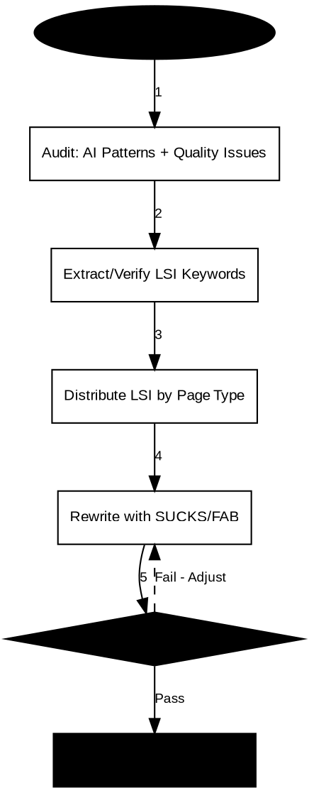

# LSI SEO Rewrite

## Overview

Production-ready SEO rewriting skill that transforms generic content into human-sounding, search-optimized prose. Integrates LSI keywords naturally, eliminates AI writing patterns across three tiers, and applies proven copywriting frameworks (SUCKS, FAB) for e-commerce content.

**Core principle:** SEO content should read like it was written by a domain expert who understands the product, the customer, and the search intent—not like an AI trying to sound helpful.

## Using seos-cli in this skill

Adoption decision: `seos-cli` is optional. It can generate project-native SEO copy drafts or keyword-based reference material, but it does not replace this skill's stricter LSI, anti-AI, SUCKS/FAB, page-type, and language-specific requirements.

Use `seos-cli` only when a draft or reference export would help before the skill performs the actual rewrite:

```powershell
seos-cli config check
seos-cli seo-text --keywords "main keyword, supporting keyword" --language en --format json --out outputs/seo-text-draft.json
seos-cli run --keywords "main keyword" --steps seo-text,export --language en --format xlsx --out outputs/seo-text.xlsx
```

Inputs: target keywords through `--keywords` or `--from-file`, plus `--language en|ru|uk`. Outputs: draft/reference JSON, CSV, or XLSX.

Do not use `seos-cli` as the final rewrite authority. The final output must still pass this skill's LSI density, AI-pattern, page-template, meta-tag, and quality-gate checks. If the task needs strict prompt/API behavior from this skill, skip `seos-cli`.

## When to Use

**Use this skill when:**
- Rewriting manufacturer product descriptions for e-commerce
- Creating category pages that guide purchase decisions
- Writing blog posts that rank and convert
- Building landing pages that sell
- Content sounds "AI-generated" or generic
- You need LSI keyword integration without keyword stuffing
- Content must pass both human and AI detection quality checks

**Page types supported:**
- **Product pages:** 300-800 words with FAB-structured features
- **Category pages:** 500+ words selection guides with navigation LSI
- **Blog posts:** Educational content with sticky phrases and PAA-based FAQs
- **Landing pages:** Conversion-focused copy with problem/solution framework

**Languages supported:** English (en), Russian (ru), Ukrainian (uk)

## Usage

### Product Page Rewriting

Use for transforming generic manufacturer descriptions into SEO-optimized product pages with FAB structure.

```
Use lsi-seo-rewrite to rewrite this product page:

[Your generic manufacturer description]

Page type: product
Language: en
Target keywords: [primary keyword], [secondary keyword]
Audience: [target segment, e.g., "home cooks", "professional chefs"]
Word count target: 500
```

**Expected output:**
- H1 with Brand + Product Name + Specific Descriptors (60-70 chars)
- Lead paragraph (100-150 words) with primary keyword + 2-3 LSI terms
- Body content (300+ words) with FAB-structured features
- Meta tags: Title (50-60 chars), Description (150-160 chars with CTA)
- LSI density: 8-12 terms per 1000 words
- FAQ section from PAA questions

**Example:** See `@references/page-templates/product-page.md` for template structure.

### Category Page Rewriting

Use for creating comprehensive category pages that guide purchase decisions and establish topical authority.

```
Use lsi-seo-rewrite to rewrite this category page:

[Your basic category listing or description]

Page type: category
Language: en
Target keywords: [primary category keyword], [secondary keywords]
LSI focus: product variety, selection criteria, audience descriptors, commercial signals
Audience: [target audience, e.g., "outdoor enthusiasts", "small business owners"]
Word count target: 600
```

**Expected output:**
- H1 with Category Name + Target Audience + Selection Signal
- Lead section (150-200 words) defining category scope
- Content blocks: Category Overview, Selection Guide, Product Types, Common Applications
- Total content: 500+ words
- Meta tags with category-specific optimization
- URL suggestions for SEO-friendly structure

**Example:** See `@references/page-templates/category-page.md` for template structure.

### Blog Post Rewriting

Use for transforming AI-generated drafts into human-sounding articles with sticky phrases and educational value.

```
Use lsi-seo-rewrite to rewrite this blog post:

[Your AI-generated or generic blog content]

Page type: blog
Language: en
Target keywords: [primary keyword]
PAA questions: [question 1], [question 2], [question 3]
Tone: professional/conversational/technical
Word count target: 1200
```

**Expected output:**
- H1 with Primary Keyword + Hook/Angle + Article Type Signal
- Hook/Lead (100-150 words) with attention grabber
- H2 sections based on PAA questions with LSI integration
- FAQ section with concise answers
- Conclusion (50-100 words) without forbidden closers
- Sticky phrases on 2-3 key points
- Blog-specific LSI: educational concepts, industry terminology

**Example:** See `@references/page-templates/blog-post.md` for template structure.

### Landing Page Rewriting

Use for creating conversion-focused landing pages with problem/solution framework and commercial intent LSI.

```
Use lsi-seo-rewrite to rewrite this landing page:

[Your generic landing page copy]

Page type: landing
Language: en
Target keywords: [primary offer keyword]
Offer: [specific value proposition]
Audience: [target customer segment]
Word count target: 800
```

**Expected output:**
- H1 with Offer/Value Proposition + Primary Benefit + Urgency/Relevance
- Hero section (above fold) with H1, subheading, CTA
- Problem/Agitation section (100-150 words) with pain-point LSI
- Solution section (150-200 words) with differentiation
- Benefits/Features in FAB format
- Social proof section (if applicable)
- FAQ section with objection handling
- Final CTA section
- Landing-specific LSI: commercial intent, trust signals, comparison terms

**Example:** See `@references/page-templates/landing-page.md` for template structure.

### Multi-Language Usage

For Russian (ru) or Ukrainian (uk) content, the skill automatically applies language-specific patterns and LSI.

```
Use lsi-seo-rewrite to rewrite this product page:

[Your Russian content]

Page type: product
Language: ru
Target keywords: [primary keyword in Russian]
```

**Language-specific behaviors:**
- Russian: Yandex optimization + Google, Cyrillic LSI terms, Russian AI patterns
- Ukrainian: Google Ukraine focus, Ukrainian LSI terms, Ukrainian AI patterns
- English: Google optimization focus, English AI patterns

See `@references/multi-language-support.md` for language-specific guidance.

## Input Schema

### Required Fields

| Field | Type | Description |
|-------|------|-------------|
| `content` | string | The content to rewrite or improve |
| `page_type` | string | One of: `product`, `category`, `blog`, `landing` |
| `language` | string | One of: `en`, `ru`, `uk` |
| `target_keywords` | array | Primary and secondary keywords to target |

### Optional Fields

| Field | Type | Description |
|-------|------|-------------|
| `lsi_keywords` | array | Specific LSI terms to integrate (if not provided, will be derived) |
| `paa_questions` | array | People Also Ask questions for FAQ sections |
| `audience` | string | Target audience (B2B vs B2C, specific segments) |
| `tone` | string | Tone preference: `professional`, `conversational`, `technical` |
| `word_count_target` | number | Target word count (defaults by page type) |
| `domain` | string | Industry domain for relevant LSI terminology |

## Output Schema

The skill produces structured output with these sections:

### 1. Audit Section

**AI Pattern Analysis:**
- Tier 1 violations found (always-remove patterns)
- Tier 2 violations found (cluster-flag patterns)
- Tier 3 violations found (density-flag patterns)
- Specific patterns flagged with line references

**Content Quality Issues:**
- Generic language problems
- Missing specificity
- Weak value propositions
- Poor flow or structure

### 2. Optimized Content

**Meta Tags:**
- Title tag (50-60 characters)
- Meta description (150-160 characters with CTA)

**Content Structure:**
- H1 with formula appropriate to page type
- Lead paragraph with primary keyword and LSI integration
- Body content with proper heading hierarchy
- FAQ section (for applicable page types)
- Schema markup suggestions (where relevant)

### 3. LSI Integration Report

**LSI Terms Used:**
- Primary keyword placement count
- Secondary keywords used
- Domain-specific terms integrated
- Total LSI density (terms per 1000 words)
- Placement verification (H1, H2, body, FAQ)

**Distribution Analysis:**
- Head/body/long-tail classification
- Search intent categories covered
- Topical authority signals present

### 4. Quality Checklist

**Verification points passed:**
- [ ] No Tier 1 AI patterns remaining
- [ ] Tier 2 patterns below clustering threshold
- [ ] Tier 3 patterns below density threshold
- [ ] Primary keyword in H1 + first 100 words
- [ ] LSI density within 8-12 terms per 1000 words
- [ ] Content passes SUCKS framework checks
- [ ] FAB structure applied (for product/landing pages)
- [ ] Meta tags optimized and within length limits
- [ ] Heading hierarchy properly nested
- [ ] Content is human-sounding and specific

## Framework Reference

This skill integrates multiple proven frameworks. See detailed references:

**LSI Integration:** `@references/lsi-frameworks.md`
- **When to use:** Every rewrite requires LSI keyword distribution
- **What it provides:** Keyword matrix structure (head/body/long-tail), distribution strategy and density rules (8-12 terms per 1000 words), SERP extraction methodology, TF-IDF application principles
- **Key concepts:** Search intent categorization, placement priority (H1 > Lead > H2/H3 > Body > FAQ)

**Anti-AI Patterns:** `@references/anti-ai-patterns.md`
- **When to use:** Content auditing and pattern removal during rewrite
- **What it provides:** Three-tier pattern detection system with 20+ always-remove patterns, 15+ cluster-flag patterns, 10+ density-flag patterns
- **Key concepts:** Tier 1 (zero tolerance), Tier 2 (cluster detection), Tier 3 (density threshold), replacement suggestions for 90% of flagged terms

**Copywriting Frameworks:** `@references/copywriting-frameworks.md`
- **When to use:** Applying human-sounding prose structure to content
- **What it provides:** SUCKS framework (Specific, Unique, Clear, Kept Simple, Sticky), FAB framework (Features, Attributes, Benefits), sticky sentence techniques, quality checklists
- **Key concepts:** Energy Transfer Test, Undeniability Test, Read-Aloud Test, Specifics-over-abstractions Test

**Product Page Template:** `@references/page-templates/product-page.md`
- **When to use:** Rewriting product descriptions and manufacturer content
- **What it provides:** H1 formula (Brand + Product + Descriptors), lead paragraph structure (100-150 words), body template (300+ words), FAB framework section, meta tag generation, 15+ quality checklist items
- **Key concepts:** Variant handling (separate vs selector pages), FAQ from PAA, technical specs table

**Category Page Template:** `@references/page-templates/category-page.md`
- **When to use:** Creating selection guides and category overviews
- **What it provides:** H1 formula (Category + Audience + Selection Signal), lead section (150-200 words), 4 content block structures, category-specific LSI categories, URL suggestions
- **Key concepts:** Product variety terms, selection criteria language, audience descriptors, commercial signals, 500+ word target

**Blog Post Template:** `@references/page-templates/blog-post.md`
- **When to use:** Rewriting articles and educational content
- **What it provides:** H1 formula (Keyword + Hook + Type Signal), article structure with hook/lead (100-150 words), PAA-based FAQ section, blog-specific LSI categories
- **Key concepts:** Educational/concept terminology, sticky phrase placement, conclusion structure without forbidden patterns

**Landing Page Template:** `@references/page-templates/landing-page.md`
- **When to use:** Creating conversion-focused pages with offers
- **What it provides:** H1 formula (Offer + Benefit + Urgency), complete landing page structure, hero section guidance, problem/agitation framework, FAB benefits section
- **Key concepts:** Commercial intent LSI, trust/credibility signals, comparison vs alternatives, social proof structure

**SEO Best Practices:** `@references/seo-best-practices.md`
- **When to use:** Ensuring content meets search engine optimization standards
- **What it provides:** On-page SEO standards (title tags, meta descriptions, heading hierarchy), commercial factors and E-A-T signals, technical SEO considerations, content quality standards
- **Key concepts:** Trust signals (SSL, policies), UGC integration (reviews, Q&A), authority signals, schema markup suggestions

**Multi-Language Support:** `@references/multi-language-support.md`
- **When to use:** Processing content in Russian or Ukrainian languages
- **What it provides:** Language-specific anti-AI patterns (5+ for Russian, 5+ for Ukrainian), language-specific LSI dictionaries, Yandex optimization for Russian, Google Ukraine guidance
- **Key concepts:** Language detection methodology, character limits per language, Cyrillic LSI integration

**Packaging LSI Dictionary:** `@references/packaging-lsi-dictionary.md`
- **When to use:** Domain-specific LSI for packaging industry content
- **What it provides:** Industry-specific terminology in English and Russian, material definitions, application contexts
- **Key concepts:** Technical packaging terms, material categories, application-specific vocabulary

**E-commerce Optimization:** `@references/Оптимизация SEO для E-commerce Сайтов.md`
- **When to use:** E-commerce specific SEO strategies (original Russian reference)
- **What it provides:** E-commerce SEO best practices, category optimization, product page strategies
- **Key concepts:** Commercial factors, user experience signals, conversion optimization

## Workflow

The skill follows this systematic workflow:



## Quality Gates

Content must pass verification across these categories before delivery:

### 1. AI Pattern Detection (Zero Tolerance for Tier 1)

**Tier 1 - Must Eliminate Completely:**
- [ ] Zero correlative constructions ("It's not X, it's Y")
- [ ] Zero rhetorical flourishes and staccato phrasing
- [ ] Zero forbidden vocabulary: delve, leverage, robust, seamless, game-changer, testament to
- [ ] Maximum 1 em dash per 1000 words
- [ ] No bold overuse or emoji in headers
- [ ] No forbidden openers ("In today's fast-paced...") or closers ("In conclusion...", "To summarize...")

**Tier 2 - Cluster Detection:**
- [ ] No clusters of 2+ Tier 2 words in single paragraph
- [ ] Monitor: harness, navigate, foster, elevate, empower, facilitate, streamline, bolster, cultivate, illuminate
- [ ] Monitor: ecosystem, myriad, plethora, encompass

**Tier 3 - Density Threshold:**
- [ ] Density < 3% for: significant, innovative, effective, dynamic, scalable, compelling, unprecedented, exceptional, remarkable

**Scoring:** Content scores 0-100 on AI pattern scale. Target: 90+ for production content.

### 2. Content Quality Verification

**SUCKS Framework Check:**
- [ ] **Specific:** ONE reader definition, not generic "many users" or "customers"
- [ ] **Unique:** Changes how they think/feel/act, not platitudes
- [ ] **Clear:** 12-year-old comprehension test passes
- [ ] **Kept Simple:** Simple ideas, simple words (no unnecessary complexity)
- [ ] **Sticky:** Contains memorable phrases or hooks

**FAB Framework Check (for product/landing pages):**
- [ ] Features clearly stated with technical accuracy
- [ ] Attributes explain why features matter (with metrics where possible)
- [ ] Benefits describe user outcomes with behavioral modifiers

**Quality Checklist Tests:**
- [ ] Energy Transfer Test: Content engages vs. informs
- [ ] Undeniability Test: Claims are specific and verifiable
- [ ] Read-Aloud Test: Flows naturally when spoken
- [ ] Specifics-over-abstractions Test: Concrete details vs. vague concepts

### 3. SEO Structure Verification

**Keyword Placement:**
- [ ] Primary keyword in H1 (first 60-70 characters)
- [ ] Primary keyword in first 100 words
- [ ] LSI keywords naturally distributed (not clustered)
- [ ] Secondary keywords in H2/H3 headings

**Technical Elements:**
- [ ] Proper heading hierarchy (H1 → H2 → H3, no skipped levels)
- [ ] Meta tags: Title 50-60 chars, Description 150-160 chars with CTA
- [ ] URL structure follows best practices (hyphens, lowercase, descriptive)
- [ ] Internal linking opportunities identified where relevant

**Content Standards:**
- [ ] Product pages: 300-800 words with FAB structure
- [ ] Category pages: 500+ words with selection guide
- [ ] Blog posts: 800+ words with PAA-based sections
- [ ] Landing pages: 400+ words with problem/solution framework

### 4. LSI Integration Verification

**Density and Distribution:**
- [ ] LSI density: 8-12 terms per 1000 words (not more, not less)
- [ ] Placement follows priority: H1 > Lead > H2/H3 > Body > FAQ
- [ ] Head/body/long-tail classification applied
- [ ] Search intent categories covered (informational, navigational, commercial, transactional)

**Topical Authority:**
- [ ] Domain-specific terminology present
- [ ] Industry concepts explained where relevant
- [ ] Related concepts integrated (not just primary keyword)
- [ ] SERP-derived terms (PAA, Related Searches) included

### 5. Language-Specific Standards

**English (en):**
- [ ] Google optimization focus applied
- [ ] English AI patterns detected and removed
- [ ] Spelling follows target variant (US/UK) consistent
- [ ] Cultural references appropriate for target audience

**Russian (ru):**
- [ ] Yandex optimization applied (titles, descriptions, keyword placement)
- [ ] Google optimization also applied (dual-platform strategy)
- [ ] Cyrillic LSI terms integrated naturally
- [ ] Russian AI patterns detected and removed
- [ ] Character limits respected (Cyrillic chars take more space)

**Ukrainian (uk):**
- [ ] Google Ukraine optimization focus applied
- [ ] Ukrainian LSI terms used (not just Russian translations)
- [ ] Ukrainian AI patterns detected and removed
- [ ] Character limits respected for Ukrainian text

### Acceptance Standards Summary

Content is ready when:
1. All Tier 1 AI patterns eliminated
2. Tier 2/3 patterns below thresholds
3. SUCKS framework checks pass (4/5 minimum)
4. SEO structure verified (keywords in H1 + first 100 words)
5. LSI density within 8-12 terms per 1000 words
6. Language-specific requirements met
7. Content is human-sounding and specific
8. Meta tags optimized and within limits

## Examples Index

See before/after transformations demonstrating the skill in action. Each example includes full input/output text, audit trail, LSI integration report, and meta tags generated.

### By Page Type

**Product Pages**
- Generic manufacturer description → SEO-optimized rewrite with FAB structure (300+ words)
- Shows: AI pattern removal, LSI density optimization, meta tag generation

**Category Pages**
- Basic listing → Comprehensive 500+ word selection guide
- Shows: Category authority building, navigation LSI integration, selection guidance structure

**Blog Posts**
- AI-generated draft → Human-sounding article with sticky phrases
- Shows: Tier 1-3 pattern removal, SUCKS framework application, PAA-based FAQ sections

**Landing Pages**
- Weak copy → Conversion-focused page with problem/solution framework
- Shows: FAB structure, commercial intent LSI, CTA optimization, objection handling

### By Language

**English (en)**
- Product page example with Google optimization
- Category page with selection guide structure
- Blog post with sticky phrases

**Russian (ru)**
- E-commerce product description → Yandex-optimized content
- Shows: Cyrillic LSI integration, Russian AI patterns, dual-platform optimization

**Ukrainian (uk)**
- Localized content → SEO-optimized with Ukrainian LSI
- Shows: Google Ukraine optimization, Ukrainian language patterns

### Example File Locations

Example files are located at: `@examples/before-after/`

Each example file contains:
1. **Input Section:** Original content before optimization
2. **Audit Section:** AI patterns detected, quality issues identified
3. **LSI Report:** Keywords used, distribution analysis, density metrics
4. **Output Section:** Fully rewritten content with all optimizations
5. **Meta Tags:** Generated title and description tags
6. **Quality Checklist:** Verification results for all quality gates

### Using Examples for Reference

When working on similar content:
1. Find the example matching your page type and language
2. Review the input to understand the starting point
3. Study the audit to see what issues were detected
4. Examine the output to understand the transformation
5. Apply the same patterns and structure to your content

### Template Reference

For detailed templates of each page type, see:
- `@references/page-templates/product-page.md`
- `@references/page-templates/category-page.md`
- `@references/page-templates/blog-post.md`
- `@references/page-templates/landing-page.md`

Templates provide the structural foundation, while examples show real-world transformations.

## Troubleshooting

### Issue 1: Content Still Sounds AI-Generated After Rewrite

**Symptoms:**
- Generic flow without specific details
- Repetitive sentence structures
- "Helpful assistant" tone
- Lack of memorable phrases or hooks

**Diagnostic Steps:**
1. Run Tier 1 pattern check - look for missed correlative constructions
2. Check sentence variety - count consecutive sentences of similar length
3. Verify specificity - count concrete nouns vs. abstractions
4. Test for sticky phrases - identify memorable lines

**Solutions:**
- Add 2-3 short, punchy sentences (8-12 words) to break flow
- Replace abstractions with concrete details (specific numbers, examples)
- Add 1-2 sticky phrases using alliteration, symmetry, or contrast
- Remove any remaining Tier 1 vocabulary
- Add specific user scenarios or use cases

### Issue 2: LSI Keywords Feel Forced or Unnatural

**Symptoms:**
- Keywords disrupt reading flow
- Same keyword repeated unnaturally
- Terms don't fit context
- Density feels "keyword-stuffed"

**Diagnostic Steps:**
1. Calculate actual LSI density (count terms / word count * 1000)
2. Check placement - are terms clustered in one section?
3. Verify term relevance to domain
4. Test reading aloud - do terms sound natural?

**Solutions:**
- Reduce density to 8-12 terms per 1000 words (maximum)
- Distribute terms across H1, lead, H2/H3, body, FAQ (not clustered)
- Replace irrelevant terms with domain-specific alternatives
- Use terms in context, not as standalone insertions
- Consider if term is truly LSI or just keyword stuffing (remove if stuffing)

### Issue 3: Content Is Too Short for Page Type

**Symptoms:**
- Product page under 300 words
- Category page under 500 words
- Blog post under 800 words
- Thin content, lacking depth

**Diagnostic Steps:**
1. Check word count against page type targets
2. Identify missing sections from template
3. Verify all template sections are complete
4. Check for expandable content areas

**Solutions by Page Type:**

**Product Pages:**
- Expand FAB section with more features/attributes/benefits
- Add technical specifications table
- Include use cases or applications
- Expand FAQ with more PAA questions
- Add comparison vs. alternatives

**Category Pages:**
- Expand selection guide with detailed factors
- Add product types section with examples
- Include common applications with use cases
- Add audience identification and guidance
- Expand category overview with differentiators

**Blog Posts:**
- Expand PAA questions into full H2 sections
- Add examples or data points
- Include step-by-step guidance
- Add industry context or background
- Expand conclusion with actionable takeaways

**Landing Pages:**
- Expand problem/agitation with specific pain points
- Add detailed benefits section with FAB
- Include social proof with specifics
- Expand objection handling in FAQ
- Add urgency/relevance elements appropriately

### Issue 4: Meta Tags Exceed Character Limits

**Symptoms:**
- Title tag over 60 characters (gets truncated in SERPs)
- Meta description over 160 characters (gets truncated)
- Primary keyword not visible in truncated preview

**Diagnostic Steps:**
1. Count characters in title tag (target: 50-60)
2. Count characters in description (target: 150-160)
3. Check where primary keyword appears
4. Identify fluff words or filler phrases

**Solutions:**

**Title Tag Optimization:**
- Focus on: Primary keyword + brand + key differentiator
- Remove: "Welcome to", "The best", "Quality", "Premium"
- Structure: [Keyword] - [Brand] or [Brand] [Keyword] - [Benefit]
- Example: "Waterproof Hiking Boots - 45+ Models | OutdoorGear Co."

**Meta Description Optimization:**
- Lead with value proposition (first 100 chars critical)
- End with CTA (last 20-30 chars)
- Cut middle filler words
- Include primary keyword naturally
- Structure: [Hook] + [Benefit] + [Differentiator] + [CTA]
- Example: "Find your perfect waterproof hiking boots from 45+ models. Free shipping, expert fit guide. Shop now with our waterproof guarantee."

### Issue 5: Heading Hierarchy Is Incorrect

**Symptoms:**
- H2 follows H4 (skipped H3)
- Multiple H1 tags on page
- No hierarchical structure
- Headings don't contain keywords

**Diagnostic Steps:**
1. List all headings in order: H1, H2, H3, etc.
2. Check for skipped levels (H1 → H3 without H2)
3. Verify only one H1 exists
4. Check keyword placement in headings

**Solutions:**
- Use exactly one H1 (primary keyword + page type signal)
- Follow hierarchy: H1 → H2 → H3 → H4 (never skip levels)
- Include primary keyword in H1
- Include secondary keywords in H2/H3 headings
- Use H2 for major sections, H3 for subsections
- Avoid H4/H5 unless content is very long and complex

### Issue 6: Russian/Ukrainian Content Has Poor Flow

**Symptoms:**
- Direct translation from English sounds unnatural
- Cyrillic LSI terms feel forced
- AI patterns not properly detected for target language
- Cultural references don't translate

**Diagnostic Steps:**
1. Identify language used in content
2. Check if language-specific patterns were applied
3. Verify LSI terms are in target language (not English terms)
4. Test reading aloud in target language

**Solutions:**

**Russian Content:**
- Apply Yandex optimization (different from Google)
- Use Cyrillic LSI from packaging dictionary
- Check for Russian AI patterns (not just English patterns)
- Ensure character limits account for Cyrillic (takes more space)
- Apply Russian sentence structure norms

**Ukrainian Content:**
- Use Ukrainian-specific LSI terms (not just Russian translations)
- Apply Google Ukraine optimization focus
- Check for Ukrainian AI patterns
- Respect Ukrainian grammar and vocabulary norms
- Account for character limits with Cyrillic

**Cross-Language Issues:**
- Never directly translate English idioms (use local equivalents)
- Adapt cultural references to local context
- Check keyword density in target language (may differ)
- Verify meta tags fit within character limits (Cyrillic expands)

### Issue 7: Pattern Detection Misses AI Writing

**Symptoms:**
- Content passes automated checks but still sounds AI
- Tier 1 patterns show 0 but content feels off
- Recurring sentence structures not flagged
- "Helpful" tone remains

**Diagnostic Steps:**
1. Manually review content for pattern clusters
2. Read content aloud - does it sound like a script?
3. Check for AI-specific sentence constructions
4. Look for "balanced" structures (AI tends to over-balance)

**Solutions:**
- Add manual pattern check after automated detection
- Look for AI-specific constructions: "While X, also Y" balance
- Check for excessive coordination (and, but, or usage)
- Verify content has "voice" or perspective
- Add opinionated takes or specific expertise signals
- Remove "both sides" framing (AI tendency to present all views equally)

## Anti-AI Pattern Summary

**Tier 1 - Always Remove (0 tolerance):**
- Structural: Correlative construction, rhetorical flourishes, staccato phrasing
- Vocabulary: delve, leverage, robust, seamless, game-changer, testament to
- Formatting: Em dashes >1 per 1000 words, bold overuse, emoji in headers
- Openers/Closers: "In today's fast-paced...", "In conclusion...", "To summarize..."

**Tier 2 - Flag in Clusters (2+ in paragraph):**
- harness, navigate, foster, elevate, empower, facilitate
- streamline, bolster, cultivate, illuminate
- ecosystem, myriad, plethora, encompass

**Tier 3 - Flag at High Density (>3% of words):**
- significant, innovative, effective, dynamic, scalable
- compelling, unprecedented, exceptional, remarkable

For complete pattern lists and replacement suggestions, see `@references/anti-ai-patterns.md`

## License

MIT License - See LICENSE file for details
